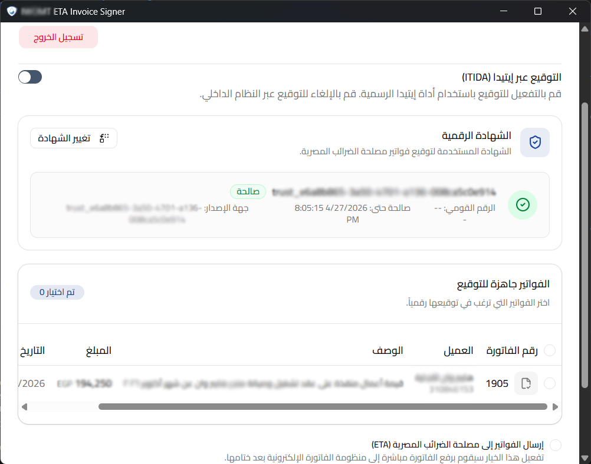
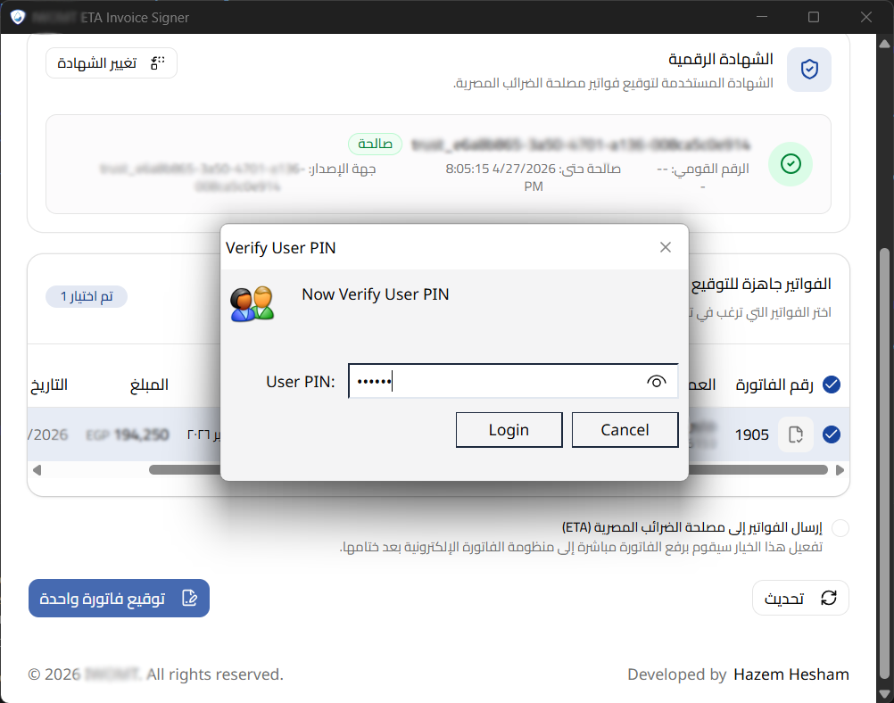
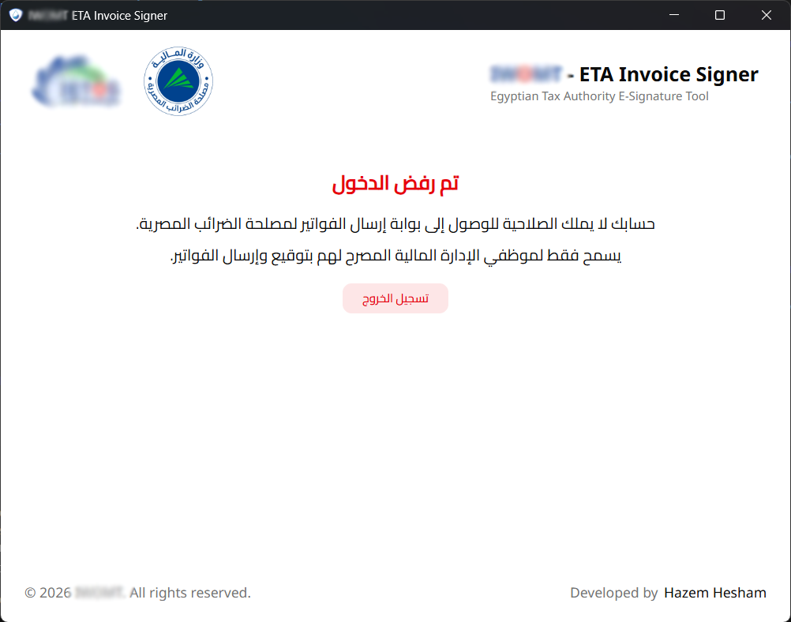
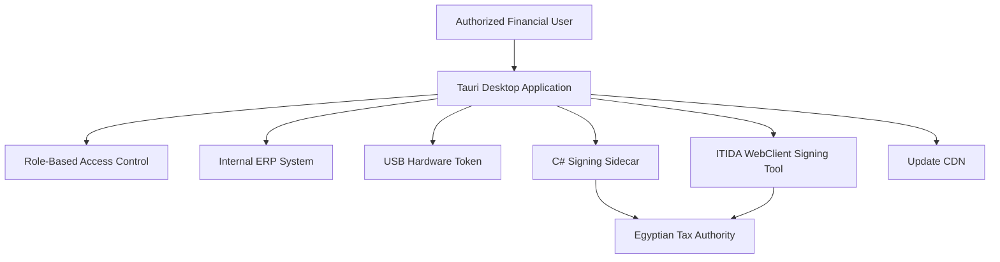

# Egyptian Tax Authority (ETA) Invoice Signing Desktop Application

A secure, lightweight Windows desktop application designed to streamline electronic invoice signing and submission to the Egyptian Tax Authority (ETA), integrated directly with an internal ERP system.

Built with **Tauri** and supported by a **C# sidecar**, the application enables authorized financial department personnel to retrieve draft invoices, select their digital signing certificates, sign invoices using compatible USB hardware tokens, and submit them to the ETA.

The application was initially developed using Electron and subsequently migrated to Tauri to reduce application bundle size and improve deployment efficiency.

---

## Overview

The application provides a centralized workflow for managing the digital signing and submission of ERP-generated invoices to the Egyptian Tax Authority.

It integrates the organization's ERP system, USB-based digital certificates, and supported signing tools into a desktop interface tailored to the financial department.

### Key Features

- **Role-Based Access Control (RBAC)** — Restricts access to authorized users within the financial department.
- **ERP Integration** — Retrieves draft invoices directly from the internal ERP system.
- **USB Hardware Token Support** — Enables digital signing using compatible hardware tokens and digital certificates.
- **Certificate Selection** — Allows users to select the appropriate available signing certificate.
- **Multiple Signing Methods** — Supports invoice signing through a C# sidecar or the ITIDA WebClient Signing Tool.
- **ETA Submission Workflow** — Facilitates the submission of signed invoices to the Egyptian Tax Authority.
- **Automatic Application Updates** — Checks for new releases and downloads and installs updates distributed through a configured CDN.
- **Lightweight Desktop Distribution** — Uses Tauri to reduce application bundle size compared with the original Electron implementation.
- **ERP-Centric Workflow** — Keeps invoice preparation within the ERP while providing a dedicated desktop application for signing and submission.

---

## Application Workflow

The typical invoice-processing workflow consists of the following steps:

1. **User Authorization**  
   The user accesses the application after the required role-based permissions have been granted.

2. **Certificate Selection**
   The application allows the user to select a digital certificate associated with a connected USB hardware token.

3. **Draft Invoice Retrieval**
   The application retrieves eligible draft invoices from the organization's ERP system.

4. **Signing Method Selection**
   The user chooses between the integrated C# sidecar signing workflow and the ITIDA WebClient Signing Tool.

5. **Digital Signature**  
   The selected signing method performs the required signing operation using the available certificate and token.

6. **ETA Submission**  
   The signed invoice is submitted to the Egyptian Tax Authority through the configured integration.

7. **Update Management**  
   The application checks for available releases and applies updates distributed through the configured CDN.

### Certificate Selection & Invoice Review

Users can select their USB hardware token certificate and review the retrieved invoice data before initiating the digital signing process.

   

### USB Hardware Token Authentication

After selecting an invoice and initiating the signing process, the application prompts the user to enter the USB hardware token PIN to authorize the digital signing operation.

   

### Unauthorized Access Restriction

The following example demonstrates the access restriction applied when an ERP-registered employee outside the financial department attempts to access the signing application.

   

---

## Technology Stack

| Component | Technology |
|---|---|
| Desktop application framework | Tauri |
| Previous desktop framework | Electron |
| Signing integration | C# sidecar |
| Alternative signing method | ITIDA WebClient Signing Tool |
| Digital signing hardware | USB hardware token |
| Certificate management | Digital certificate selection |
| Business data source | Internal ERP system |
| Access control | Role-Based Access Control (RBAC) |
| Application distribution | CDN |
| Update mechanism | Automatic version checking and updating |
| Target platform | Microsoft Windows |
| Tax integration | Egyptian Tax Authority (ETA) |

---

## Architecture

The application acts as a desktop integration layer between the financial department, the internal ERP system, digital signing components, and the Egyptian Tax Authority.

The diagram illustrates the application's logical components. The exact signing and submission paths depend on the selected signing method and the corresponding integration.

### Architectural Responsibilities

- **Tauri desktop layer:** Provides the Windows application interface and coordinates invoice-signing workflows.
- **ERP integration:** Supplies draft invoice data for processing.
- **Access control:** Limits application functionality to appropriately authorized users.
- **Signing layer:** Integrates the C# sidecar and ITIDA WebClient Signing Tool as alternative signing methods.
- **Hardware token:** Provides access to the user's digital certificate and the associated signing capability.
- **ETA integration:** Supports submission of signed invoices to the tax authority.
- **Update infrastructure:** Distributes application releases through a configured CDN.

---

## Automatic Updates

The application includes an automatic update mechanism to simplify deployment and maintenance across user workstations.

When a new version is released and published to the configured CDN, the application checks for available updates and initiates the update process when a newer version is detected.

### Update Workflow

1. A new application version is released.
2. The release artifacts and required update metadata are published to the CDN.
3. The desktop application checks for a newer version.
4. When an update is available, the application downloads and applies it according to the configured update process.

This approach reduces the need to manually redistribute the application whenever a new release is published.

**Security recommendation:** Production updates should use signed update artifacts, trusted update metadata, and HTTPS. Private signing keys should be protected outside the distributed application.

---

## Security Considerations

Because the application handles digital certificates, invoice data, and tax submissions, security is an important part of its design and deployment.

The application incorporates role-based access control to restrict use to authorized financial department personnel.

Recommended operational safeguards include:

- Enforcing authorization on the ERP or backend, rather than relying exclusively on client-side access restrictions.
- Protecting USB token PINs and never storing them in application configuration files or logs.
- Keeping certificate private keys within the supported hardware-token signing mechanism whenever possible.
- Using HTTPS for ERP communication, ETA integration, and update distribution.
- Verifying update signatures and preventing unauthorized update packages from being installed.
- Avoiding sensitive invoice data, credentials, and certificate information in diagnostic logs.
- Restricting access to signing operations and maintaining appropriate audit records.
- Validating invoice data and signing results before submission.

Actual security guarantees depend on the application's implementation, its backend services, and the configuration of the signing components.

---

## Prerequisites

The following components may be required to operate the application, depending on the deployment configuration:

- A supported Windows desktop environment.
- An authorized user account with the required application permissions.
- Access to the internal ERP system and its invoice services.
- A compatible USB hardware token and valid digital certificate.
- The required token drivers and certificate middleware.
- The C# sidecar and its runtime dependencies, if required by the selected deployment.
- The ITIDA WebClient Signing Tool, when using that signing method.
- Network access to the configured ETA integration endpoints.
- Network access to the configured update CDN.

Refer to the organization's deployment documentation for the exact supported Windows versions, drivers, runtime requirements, and endpoint configuration.

---

## Installation

1. Obtain the approved Windows installer from the organization's software distribution channel.
2. Install the application using the provided installer.
3. Connect the supported USB hardware token.
4. Install or verify the required token drivers and signing components.
5. Launch the application and sign in using an authorized account.
6. Confirm access to the ERP system and select the appropriate digital certificate.
7. Retrieve the required draft invoices and proceed with the signing workflow.

Installation and configuration requirements may vary depending on the selected signing method.

---

## Typical Use Cases

- Signing ERP-generated electronic invoices before submission to the ETA.
- Allowing authorized financial personnel to process invoices through a dedicated desktop application.
- Supporting alternative digital signing workflows through the C# sidecar or ITIDA WebClient Signing Tool.
- Simplifying deployment and maintenance through CDN-based automatic updates.
- Reducing desktop application distribution size through migration from Electron to Tauri.

---

## Development and Maintenance

The application is maintained as part of the organization's internal software ecosystem and integrates with its ERP system.

Development and maintenance activities may include:

- Improving the desktop application interface and signing workflow.
- Maintaining compatibility with hardware tokens and signing tools.
- Updating ERP integration and invoice-processing functionality.
- Maintaining compatibility with ETA integration requirements.
- Publishing application releases and update artifacts to the CDN.
- Improving security, reliability, and deployment efficiency.

Development commands, environment variables, build instructions, and release procedures should be documented according to the actual repository structure and deployment pipeline.

---

## Acknowledgements & Technical Attribution

The C# invoice canonicalization and digital signing implementation used in this project is based on the work originally developed by **[bassemAgmi](https://github.com/bassemAgmi)** in the following repository:

- **Original repository:** [EInvoicingSigner](https://github.com/bassemAgmi/EInvoicingSigner)

The original implementation provides the core logic for invoice JSON serialization, canonicalization, and digital signature generation for Egyptian Tax Authority (ETA) e-invoicing documents.

### Adaptations and Enhancements

The original implementation was designed around a file-based workflow, where invoice documents were read from JSON files and the resulting signed documents were written back to files.

For this project, the signing implementation was adapted to support direct inter-process communication between the **Tauri Rust backend** and a **C# sidecar**, eliminating the dependency on intermediate JSON files.

The adaptations include:

- Reworking JSON input handling to accept invoice payloads directly from the Rust backend.
- Implementing JSON-based communication between Tauri and the C# sidecar.
- Integrating the signing process into the desktop application's invoice-processing workflow.
- Returning the generated digital signature as a Base64-encoded value to the Rust backend.
- Adapting the original file-oriented workflow to a more integrated sidecar-based architecture.

These changes allow the application to invoke the C# signing functionality directly from Tauri while maintaining the underlying canonicalization and signing logic.

**Credit:** Full credit for the original implementation belongs to [bassemAgmi](https://github.com/bassemAgmi). The modifications and integration into the Tauri-based desktop application were developed as part of this project.

---

## License

This project is intended for internal organizational use.

Unless otherwise specified by the project owner, the source code and associated materials are proprietary and may not be redistributed or reused without authorization.